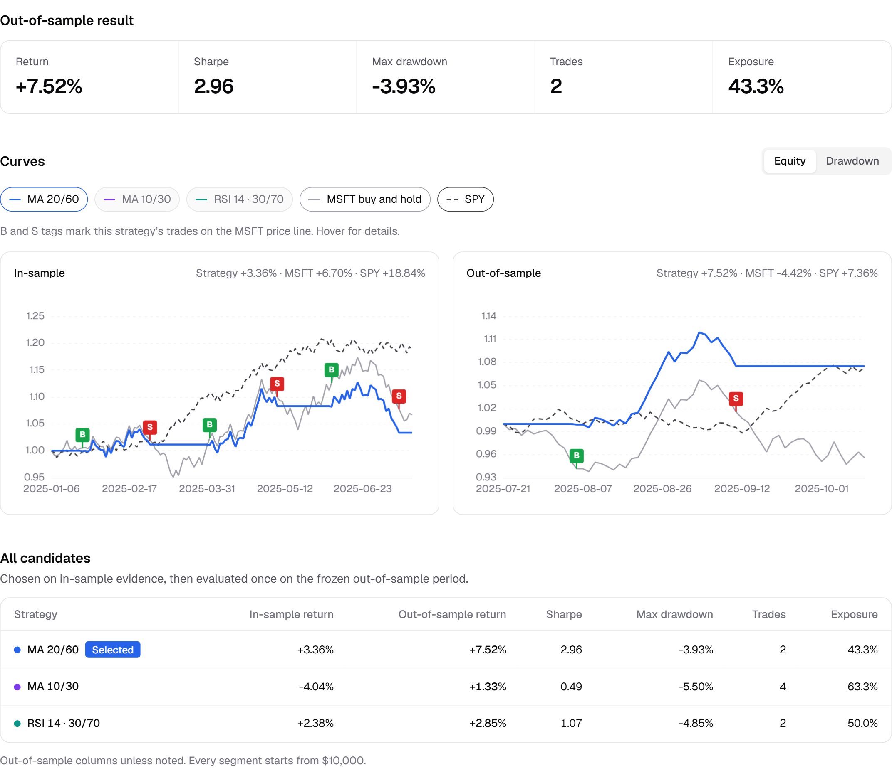
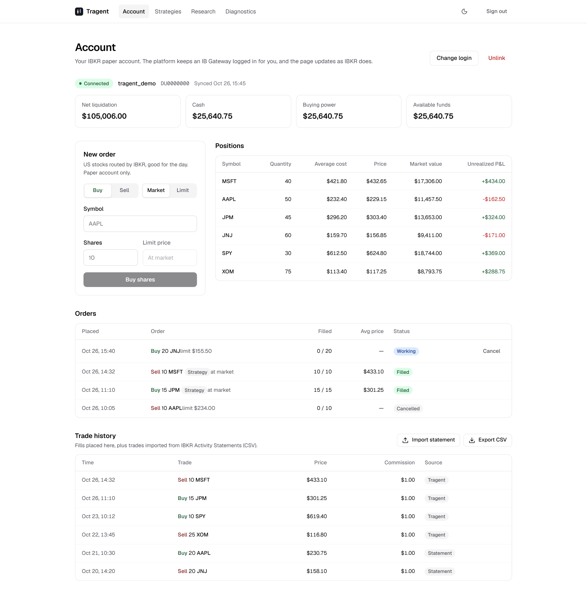
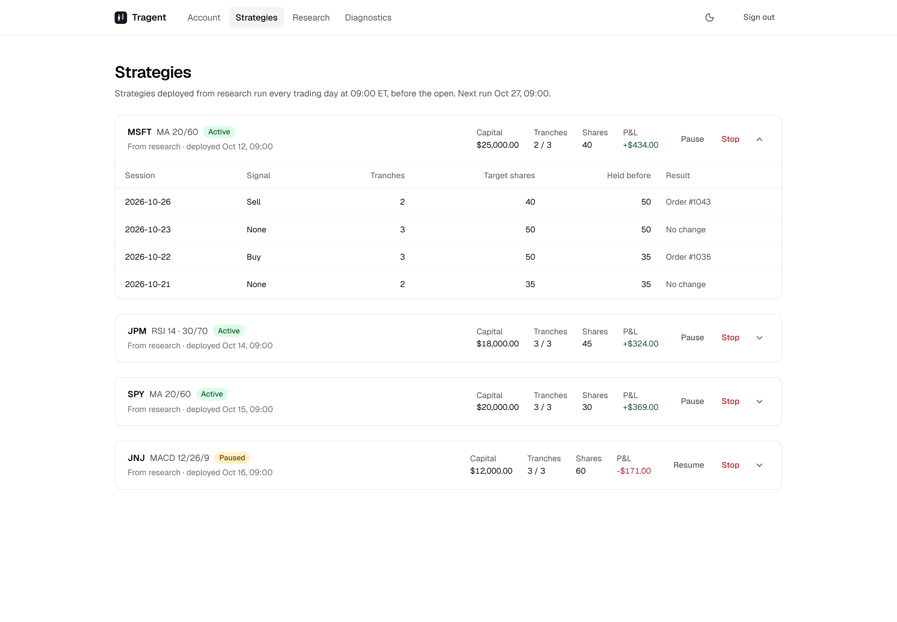
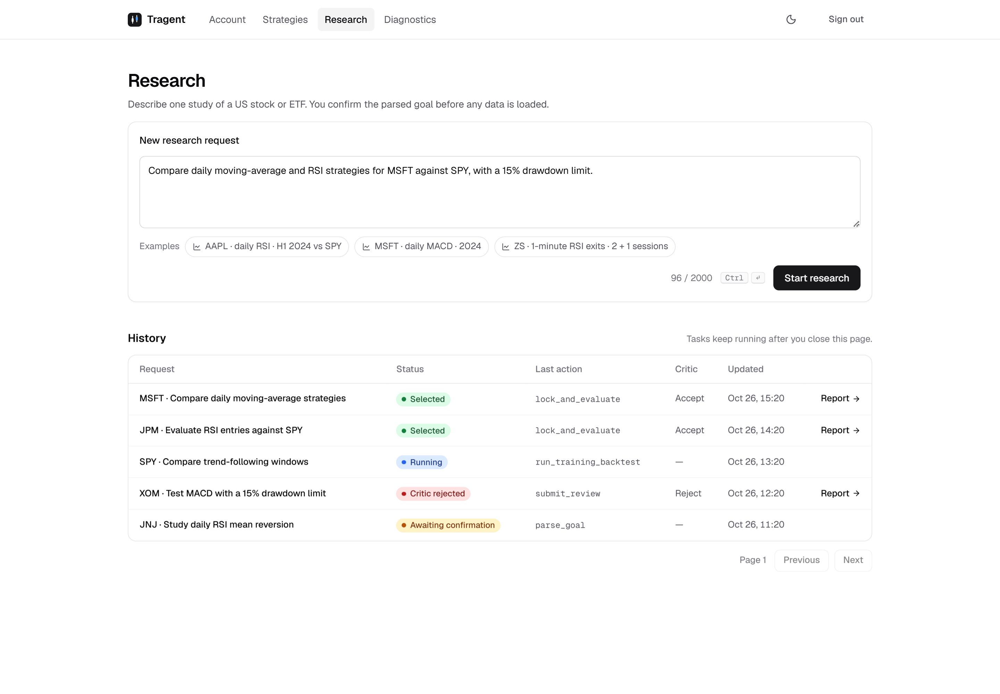
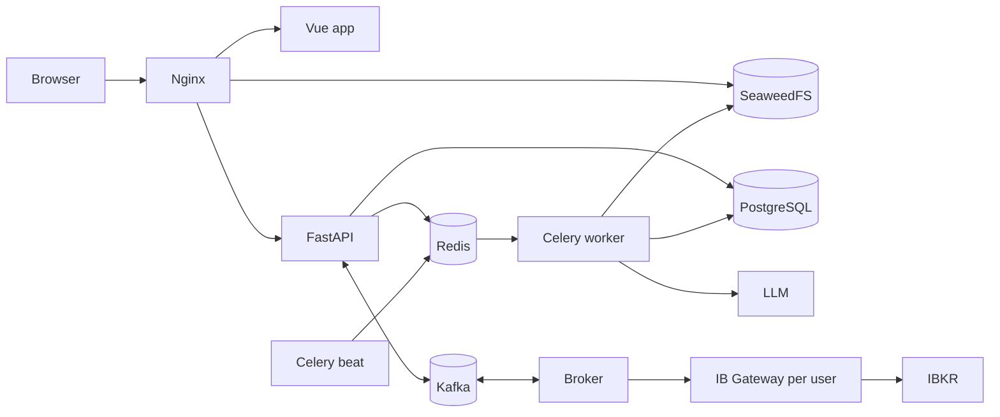

# Tragent

Tragent researches US equity strategies with LLM agents and trades the accepted ones through
Interactive Brokers. It supports multiple users, each with their own IBKR account.

Trading currently runs on IBKR paper accounts only. Live account support is coming soon.

[](assets/report.png)

<sub>Screenshots use demo data.</sub>

<details>
<summary>Account, strategies & research</summary>

[](assets/account.png)

[](assets/strategies.png)

[](assets/research.png)

</details>

## Features

Research:

- A Research Agent and a Critic Agent, each a LangChain `create_agent` loop with its own tools.
  The Critic can accept a draft, reject it, or send it back for one revision.
- Requests are written in plain language. The parsed goal is shown for confirmation, and missing
  details are asked for, before any research starts.
- Market data, backtests, costs, and metrics are computed in Python. The model only reads compact
  summaries of the results.
- Out-of-sample results stay hidden until a candidate is locked. Agent steps and tool calls have
  fixed budgets.
- SEC filings, Yahoo Finance news, StockTwits, and Reddit posts are retrieved through pgvector as
  supporting context.
- Tasks run on Celery workers and are checkpointed in PostgreSQL after every step, so they keep
  running after the browser closes and can be resumed after a failure.

Trading:

- Each linked IBKR login runs in its own IB Gateway container.
- Orders are idempotent and sent to a single broker process over Kafka. The broker reconciles
  with the Gateway and resends any lost command.
- Orders, balances, and positions update in the browser over a WebSocket.
- Deployed strategies run every trading day at 09:00 ET with the same code as the backtest.
- IBKR Activity Statements (English or Chinese) can be imported, and the trade history can be
  exported as CSV.

## Architecture



| Service | Description |
| --- | --- |
| `api` | REST API, SSE for research progress, WebSocket for trading, Gateway management |
| `worker` | Runs research tasks and strategy deployments |
| `beat` | Schedules the daily deployment run |
| `broker` | Holds all Gateway connections, places orders, syncs accounts |
| `web` | Nginx serving the Vue app and proxying the API and object store |

## Strategies

All strategies are long-only.

| Strategy | Bars | Rule |
| --- | --- | --- |
| `moving_average`, `rsi`, `macd` | Daily, 1-minute | Standard parameterized signals |
| `intraday_rsi` | 1-minute | RSI(14) below 30 to buy, above 70 to sell |
| `rsi_price_exit` | 1-minute | Exit at VWAP or RSI 70, depending on the entry price |
| `rsi_vwap_exit` | 1-minute | Buy only below VWAP, exit at VWAP |

Minute strategies close out every position by the end of the session. Yahoo Finance only keeps
30 days of minute bars, so a minute study covers at most 20 sessions.

## Tech Stack

| Layer | Technologies |
| --- | --- |
| Agents | LangChain, LangGraph, LangSmith |
| Backend | Python, FastAPI, Pydantic, psycopg, Alembic |
| Data | PostgreSQL + pgvector, Redis, Kafka, SeaweedFS |
| Jobs | Celery |
| Brokerage | IB Gateway, ib_async, Docker SDK |
| Market data | yfinance, exchange-calendars |
| Frontend | Vue 3, Vite, Pinia, Tailwind CSS, Reka UI, ECharts |
| Deployment | Docker Compose, Nginx |

## Getting Started

Requirements:

- Docker with Compose
- An OpenAI-compatible chat model and an embeddings endpoint
- A LangSmith API key
- An IBKR login for each user who links an account
- Python 3.13+ and Node.js 22.18+ for local development

Copy the environment file, fill it in (see the comments in [`.env.example`](.env.example)), and
pull the Gateway image:

```bash
cp .env.example .env
docker pull ghcr.io/gnzsnz/ib-gateway:latest
```

### Docker

```bash
docker compose --profile app up -d --build
```

Open <http://localhost:8080>, register, and link an IBKR login on the Account page. Migrations run
before the app starts.

### Local development

Start the infrastructure, install the package, and migrate:

```bash
docker compose up -d
python -m pip install -e ".[dev]"
alembic upgrade head
```

Then start each process in its own terminal:

```bash
uvicorn tragent.api.app:create_app --factory --reload
```

```bash
celery -A tragent.worker worker --concurrency=16 --loglevel=info
```

```bash
celery -A tragent.worker beat --loglevel=info
```

```bash
python -m tragent.trading.broker
```

```bash
cd frontend && npm ci && npm run dev
```

The frontend runs at <http://localhost:5173> and proxies `/api` to FastAPI. API docs are at
<http://127.0.0.1:8000/docs>. The API needs access to the Docker socket to manage Gateways, and
`POSTGRES_POOL_MAX_SIZE` should be at least twice the worker concurrency.

## Deployment

To run more API replicas:

```bash
docker compose --profile app up -d --scale api=2
```

Workers can run on any machine that reaches PostgreSQL, Redis, Kafka, and SeaweedFS.

The frontend and API can be deployed separately on subdomains of the same root domain, such as
`app.example.com` and `api.example.com`. The refresh token cookie is `SameSite=Strict`, so
different root domains won't work.

```bash
docker build --build-arg VITE_API_BASE_URL=https://api.example.com -t tragent-web frontend
```

```dotenv
CORS_ORIGINS=["https://app.example.com"]
S3_PUBLIC_URL=https://files.example.com
```

## Development

```bash
python -m pytest
ruff check src tests scripts
cd frontend && npm run type-check && npm run test:unit -- --run
```

Tests don't call external services. Agent evaluations use a real model:

```bash
python scripts/run_agent_evals.py               # decision scenarios
python scripts/run_agent_evals.py --with-smoke  # plus an end-to-end run
```

## Project Structure

```text
src/tragent/
├── api/          # FastAPI app, auth, diagnostics
├── research/     # research workflow, persistence, reports
│   └── agent/    # agents, tools, prompts
├── quant/        # market data, strategies, backtests
├── trading/      # Gateways, broker, orders, deployments, statements
├── storage.py    # object store
└── worker.py     # Celery app and schedule
frontend/         # Vue app and Nginx config
migrations/       # Alembic migrations
scripts/          # agent evaluations
```

## License

[MIT](LICENSE)

Backtest results are not investment advice.
