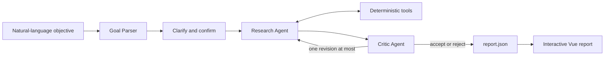

# Tragent

An end-to-end, durable AI agent system for US equity strategy research.

Describe a research objective in natural language, confirm the parsed goal, and let a Research
Agent investigate candidate strategies with deterministic tools. A separate Critic Agent then
reviews the frozen evidence before the application produces an interactive report.

> This is a learning and research project. It is not an investment advisory service or a live
> trading system.

## Key Features

- **Research and Critic Agents** - The Research Agent chooses its next action dynamically. The
  Critic Agent reviews the draft independently and either accepts it, requests a single revision,
  or rejects it.
- **Human-in-the-loop goals** - The workflow pauses for clarification when a request is incomplete
  and starts research only after the user confirms the structured research goal.
- **Durable execution** - LangGraph checkpoints persist human decisions, agent actions,
  observations, and budgets in PostgreSQL so interrupted tasks can resume.
- **Deterministic research tools** - Market data, statistics, backtests, costs, metrics, and trade
  ledgers are computed in Python rather than generated by the model.
- **Controlled model context** - Tools return structured observations; raw DataFrames, full price
  series, and trade ledgers stay outside the LLM context.
- **Real-time web UI** - FastAPI streams agent progress and budget updates over SSE, while Vue
  provides task history, resume controls, diagnostics, and interactive reports.

## How It Works



The outer LangGraph workflow controls goal parsing, human approval, agent handoff, and
termination. Inside that workflow, the Research Agent uses a ReAct loop to gather evidence and
select a candidate. The Critic Agent has access to its own restricted tool set and can inspect,
but not modify, the frozen research evidence.

The project currently supports long-only moving-average, RSI, and MACD strategies using either
daily bars or one-minute bars covering complete XNYS trading sessions.

## Tech Stack

| Layer | Technologies |
| --- | --- |
| Agents | LangChain, LangGraph, LangSmith |
| Backend | Python 3.13, FastAPI, Pydantic, psycopg |
| Persistence | PostgreSQL, LangGraph PostgresSaver and PostgresStore |
| Market research | yfinance, exchange-calendars, deterministic Python backtests |
| Frontend | Vue 3, Vite, Pinia, Vuetify, Plotly.js |

## Quick Start

### Prerequisites

- Python 3.13+
- PostgreSQL
- Node.js 22.18+ or 24.12+
- An LLM endpoint compatible with the OpenAI Responses API
- A LangSmith API key

The commands below have been tested on Linux and WSL.

### 1. Install the backend

```bash
python -m venv .venv
source .venv/bin/activate
python -m pip install -e ".[dev]"
cp .env.example .env
```

Edit `.env` with your model, LangSmith, PostgreSQL, and JWT settings. Generate a suitable
`JWT_SECRET` with:

```bash
python -c "import secrets; print(secrets.token_urlsafe(48))"
```

### 2. Initialize PostgreSQL

Create the database configured in `.env`, then create the application-owned table:

```bash
psql -h localhost -U your-user -d trading -f schema.sql
```

Create a user for the web application:

```sql
INSERT INTO users (username, password)
VALUES ('researcher', 'change-me');
```

LangGraph creates its checkpoint and store tables through the official `setup()` methods when
FastAPI starts for the first time.

> The current authentication layer is intentionally minimal and stores passwords in plaintext.
> Do not use it as-is in a production deployment.

### 3. Start FastAPI

```bash
uvicorn trading.api.app:app --reload
```

The API runs at `http://127.0.0.1:8000`. Interactive API documentation is available at
`http://127.0.0.1:8000/docs`.

### 4. Start Vue

```bash
cd frontend
npm ci
npm run dev
```

Open `http://localhost:5173` and sign in with the user created above. During development, Vite
proxies `/api` requests to FastAPI.

## Example

```text
Evaluate an RSI strategy for AAPL using daily bars from 2024-01-01 through
2024-06-30. Apply a 40% maximum-drawdown constraint and compare the strategy with
SPY. Use 5 bps transaction costs and 5 bps slippage.
```

If the request is incomplete, the Goal Parser identifies the missing fields and suggests a
concrete follow-up request. Once confirmed, the Research Agent starts working and the UI displays
the active agent, current operation, and remaining budgets for agent steps and tool calls. Paused
or interrupted tasks remain available in the task history.

The final report combines:

- the Research Agent's selected candidate and conclusion;
- the Critic Agent's review and final verdict;
- in-sample and out-of-sample performance for the asset, benchmark, and strategies;
- interactive equity and drawdown charts;
- expandable trade details.

## Design Principles

- **Agent autonomy** - The model chooses what to investigate, which tool to call, how to interpret
  bounded evidence, and when to submit a result.
- **Deterministic execution** - Deterministic Python code handles market data, validation,
  backtests, metrics, trade ledgers, candidate locking, and report data.
- **Separated responsibilities** - Research and Critic use different tool sets, and the Critic
  cannot alter frozen research evidence.
- **Controlled information flow** - Out-of-sample evidence becomes available only after a
  candidate is locked, while explicit budgets cap agent steps and tool calls.

## Testing and Agent Evaluation

The default test suite uses local fixtures and model doubles. It does not call external services:

```bash
pytest
ruff check src tests scripts

cd frontend
npm run type-check
npm run test:unit -- --run
npm run build
```

Run the checked-in Agent evaluation set with a real model:

```bash
python scripts/run_agent_evals.py
```

This command runs eight synthetic decision scenarios through the real model and checks Research
and Critic tool permissions, budgets, required actions, and verdicts. It is not eight end-to-end
market research runs.

Run the optional end-to-end smoke test with HITL, PostgreSQL, live market data, both agents, and
report generation:

```bash
python scripts/run_agent_evals.py --with-smoke
```

Real-model evaluations and the smoke test call external services, may incur API costs, and depend
on model-provider and market-data availability.

## Security and Scope

- Authentication is intentionally minimal and is not suitable for production.
- Production deployments must configure the allowed frontend origin in
  `src/trading/api/app.py`.
- The application does not execute model-generated Python or place live orders.
- Reports are research artifacts, not financial advice or trading instructions.

## Contributing

Issues and pull requests are welcome. Run the relevant backend tests, frontend tests, and static
checks before submitting a change.

## License

This project is licensed under the [MIT License](LICENSE.txt).

## Disclaimer

This repository is intended for learning about agent architecture, software engineering, and
quantitative research methods. Example results are not indicative of future performance and must
not be treated as investment advice.
